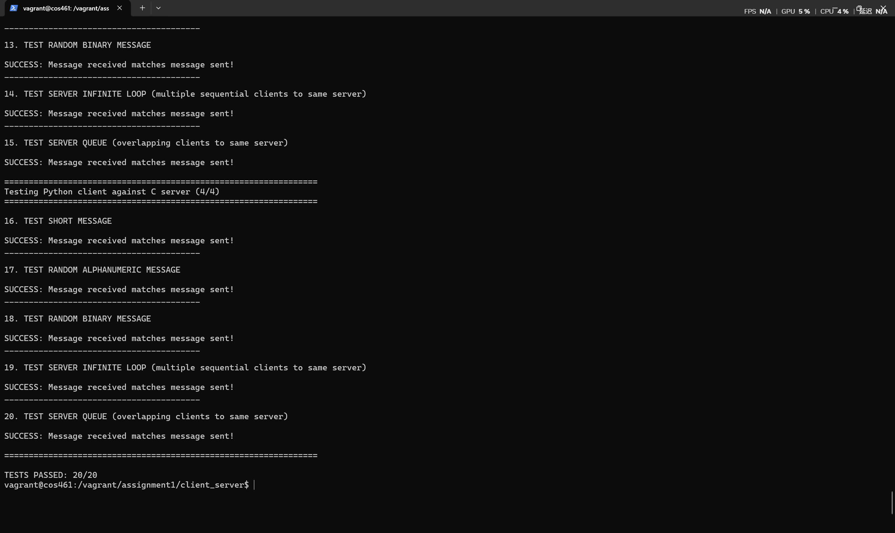

# 华东师范大学数据科学与工程学院实验报告

- 课程名称：计算机网络
- 年级：大二
- 指导教师：赵明昊
- 姓名：刘嘉逸
- 学号：10254602402

## 一、实验任务

本次实验为 Assignment 1：虚拟机配置与 Socket 编程。我选择 C 和 Python，完成 `client-c.c`、`server-c.c`、`client-python.py`、`server-python.py` 四个程序。

客户端根据命令行给出的服务器 IP 和端口建立 TCP 连接，从标准输入分块读取数据，原样发送到服务器，直到 EOF，然后关闭连接。服务器根据命令行给出的端口监听连接，将收到的数据原样写入标准输出，并持续等待下一位客户端。服务器依次处理客户端，连接等待队列长度设为 10，不使用多线程或多进程。

除了普通文本，还需要正确传输长消息和随机二进制数据。因此程序不能依赖字符串结束符判断数据长度，也不能一次把全部输入读入内存。C 客户端需要处理部分发送，服务器需要及时刷新输出缓冲区。最后使用课程提供的测试脚本检查 C、Python 之间的四种客户端与服务器组合。

## 二、使用环境

本次实验采用“在 WSL 中编辑，在 Windows 启动的 Vagrant 虚拟机中编译和测试”的方式。

| 用途 | 使用环境 |
|---|---|
| 宿主系统 | Windows |
| 代码编辑 | WSL Ubuntu，仓库位于 `/home/liujiayi/programming/COS461` |
| 虚拟机管理 | Windows 上的 Vagrant 与 VirtualBox |
| 编译和运行 | 课程提供的旧版 Ubuntu 虚拟机 |
| C 构建 | 虚拟机中的 GCC 和课程提供的 Makefile |
| Python 运行 | 虚拟机中的 Python 3 |
| 自动测试 | Bash 脚本 `test_client_server.sh` |
| 虚拟机中的工作目录 | `/vagrant/assignment1/client_server` |

环境配置比预期更费时间。最初直接在 Windows 上编辑时，编辑器与 Linux 作业环境没有适配好，代码提示和实际运行环境不一致，没有自动补全，语法高亮等功能，使用起来很难受。我又尝试通过 VS Code Remote-SSH 连接课程的 vagrant 虚拟机，但虚拟机的 Ubuntu 版本过低，无法满足所用 VS Code Server 的依赖要求。

最终我保留课程虚拟机作为编译和测试环境，在 WSL 中编辑代码，再将代码同步到 Windows 上供 Vagrant 使用的目录，在 Windows 中启动虚拟机并进入其中编译、运行和测试。WSL 仓库与 Windows 的 Vagrant 共享目录是不同位置，修改后需要保证测试目录中的代码与编辑版本一致，不能默认它们自动同步。

## 三、实验过程

### 1. 阅读要求与确定实现方案

我阅读了《实验1说明.pdf》《注意事项.pdf》《计算机网络实践课-Assignment1.pdf》、首次实验课件以及仓库中的 README，确认必须完成 C 和另一种语言的两套程序，第二种语言选择 Python。

### 2. C 客户端实现与关键代码

客户端通过 `argv` 接收服务器 IP 和端口。先设置 `hints`，再调用 `getaddrinfo()`，将输入的地址和端口转换成 socket 函数所需的地址信息：

```c
struct addrinfo hints = {0};
hints.ai_family = AF_INET;
hints.ai_socktype = SOCK_STREAM;
int status = getaddrinfo(server_ip, server_port, &hints, &result);
```

`hints` 是输入筛选条件，`result` 指向结果链表。函数返回值表示地址解析成功与否，不能代表连接成功。发生解析错误时，用 `gai_strerror(status)` 获取说明。

接着通过 `socket()` 创建通信端点，通过 `connect()` 连接服务器。连接成功后，内核已经保存连接所需的地址信息，可以释放 `result`。

客户端使用 2048 字节缓冲区，分块读取和发送：

```c
while ((bytes_read = fread(buffer, 1, sizeof(buffer), stdin)) > 0) {
    size_t offset = 0;
    while (offset < bytes_read) {
        ssize_t sent = send(sockfd, buffer + offset,
                            bytes_read - offset, MSG_NOSIGNAL);
        if (sent == -1 && errno == EINTR)
            continue;
        if (sent <= 0) {
            /* 实际代码在这里输出错误、关闭 socket 并返回失败 */
            close(sockfd);
            return 1;
        }
        offset += (size_t)sent;
    }
}
```

外层循环读取输入，内层循环保证本次读入的字节全部发送。`offset` 表示当前块已发送的字节数，`buffer + offset` 是剩余数据的起始地址。TCP 是字节流，一次 `send()` 不保证发送全部请求的数据，也不保证服务器一次 `recv()` 就得到同样长度的数据。

`fread()` 返回 `size_t`，因此读取长度和偏移使用该类型；`send()` 返回 `ssize_t`，因为失败需要表示 `-1`。`EINTR` 表示系统调用被信号中断，可以重新尝试。`MSG_NOSIGNAL` 避免连接异常时 SIGPIPE 信号直接终止进程，让代码能够处理发送错误。

读取循环结束后检查 `ferror(stdin)`，区分正常读到 EOF 与读取错误，最后关闭 socket。标准输入既可以来自终端，也可以由 shell 使用 `<` 重定向文件，或通过管道接收其他程序的输出。

### 3. C 服务器实现与关键代码

服务器设置 IPv4、流式 socket 和 `AI_PASSIVE`，通过以下调用生成本机绑定地址：

```c
hints.ai_family = AF_INET;
hints.ai_socktype = SOCK_STREAM;
hints.ai_flags = AI_PASSIVE;
getaddrinfo(NULL, server_port, &hints, &result);
```

在这些条件下，生成的 IPv4 地址为 `0.0.0.0`，表示绑定本机所有 IPv4 接口，而不是只允许本机客户端访问。

服务器依次执行 `socket()`、`bind()`、`listen()`。其中 `bind()` 确定本机地址和端口，`listen()` 进入监听状态，`QUEUE_LENGTH` 为 10。随后调用：

```c
int client_fd = accept(listen_fd, NULL, NULL);
```

`listen_fd` 持续负责监听，`client_fd` 是接受连接后返回的新描述符，负责与当前客户端通信。没有待接受的连接时，`accept()` 阻塞等待。这里传入两个 `NULL`，表示不需要取得客户端地址信息。

服务器内层循环通过 `recv()` 接收当前客户端数据，返回正数表示实际收到的字节数，返回 0 表示对端正常结束发送且数据已经读完，返回 -1 表示错误。收到数据后，通过 `fwrite()` 按实际长度写入标准输出，再调用 `fflush(stdout)`：

```c
size_t written = fwrite(buffer + offset, 1,
                        (size_t)received - offset, stdout);
/* 检查返回值和输出错误，并更新 offset */
fflush(stdout);
```

每项大小为 1 字节，因此这里 `fwrite()` 返回值等于写入的字节数。刷新输出是为了避免重定向到文件时，数据仍留在程序缓冲区中，而测试脚本终止服务器后造成结果缺失。当前客户端结束后关闭 `client_fd`，外层循环继续接受下一位客户端。

按照教师关于无需筛选地址链表的说明，我后来把 C 服务器改成只尝试首个地址。目前仍保留 `for` 语法，但条件为 `address == result`，对于正常返回的非空链表，只处理首个节点。C 客户端也做了相同修改。教师该条说明针对服务器；客户端当前不再尝试后续候选地址，因此相较原版本减少了对多地址情况的兼容性，不能把这种简化理解为通用网络客户端的最佳写法。

### 4. Python 客户端与服务器实现

Python 客户端使用：

```python
input_stream = getattr(sys.stdin, "buffer", sys.stdin)
connection = socket.create_connection((server_ip, server_port))
```

在正常 Python 3 环境中，`input_stream` 指向 `sys.stdin.buffer`，读取原始字节而不进行文本解码。`create_connection()` 封装了地址解析、socket 创建和连接过程。循环读取 2048 字节后，调用 `sendall(data)`，由库负责继续发送尚未发送完的数据。通过 `finally` 保证连接关闭。

Python 服务器创建监听 socket，绑定本机所有 IPv4 接口并监听：

```python
listener = socket.socket(socket.AF_INET, socket.SOCK_STREAM)
listener.bind(("", server_port))
listener.listen(QUEUE_LENGTH)
connection, _ = listener.accept()
```

`listener` 是监听 socket，`connection` 是当前客户端的通信 socket。`accept()` 还返回客户端地址，这里不使用，赋给 `_`。内层循环如下：

```python
data = connection.recv(RECV_BUFFER_SIZE)
if not data:
    break
output_stream.write(data)
output_stream.flush()
```

`recv()` 返回 `bytes`，空字节串表示当前连接的数据接收结束。`output_stream` 来自 `sys.stdout.buffer`，原样输出数据；错误信息使用 `sys.stderr.write()` 输出，避免混入接收结果。异常通过 `try / except` 处理，连接通过 `finally` 关闭。

我没有采用 `scanf("%s", ...)`、`printf("%s", ...)` 或 Python 的 `input()`、`print()` 传输消息，因为这些方法面向文本，可能遇到空白截断、零字节截断、文本解码或自动添加换行等问题。按字节读写更适合本实验的二进制数据要求。

### 5. 编译、测试与问题排查

所有实际编译和测试均由我在 Vagrant 虚拟机中执行，AI 辅助阅读源码和解释问题，没有在 WSL 中代替我运行测试。

第一次在虚拟机中执行：

```bash
cd /vagrant/assignment1/client_server
bash test_client_server.sh python3 8080
```

结果为 `5/20`。Python 客户端与 Python 服务器的五项测试全部成功，其余三组都显示：

```text
One or both programs missing. Skipping.
```

原因是测试脚本需要 `client-c` 和 `server-c` 可执行文件，不会自动编译 C 源码。我忘记在虚拟机中执行 `make`，生成这两个文件后重新测试，全部 20 项通过。第一次使用的 8080 并不是跳过测试的原因；作业建议使用 10000～60000 的端口，后续可以选择如 18080。

在整理代码、把 socket 创建逻辑拆成辅助函数时，我又遇到测试仅通过 `11/20` 的情况。检查源码发现 C 服务器的 `create_socket()` 漏写了 `return listen_fd;`。局部变量不会自动成为返回值，调用方使用缺失的返回值会导致未定义行为。补上返回语句后继续测试。

后续阅读代码时，检查发现我把 C 客户端的错误判断写成了 `ferror(stdin) == 0`，会在正常读取结束后打印错误并返回失败。我已经修改为：

```c
if (ferror(stdin) != 0) {
    fprintf(stderr, "Failed to read standard input\n");
    close(sockfd);
    return 1;
}
```

### 6. 实验结果与分析

测试脚本对四种组合分别执行五项测试，共 20 项：

| 组合 | 检查内容 |
|---|---|
| C 客户端 → C 服务器 | 短消息、随机长文本、随机二进制、依次连接、重叠连接 |
| Python 客户端 → Python 服务器 | 同上 |
| C 客户端 → Python 服务器 | 同上 |
| Python 客户端 → C 服务器 | 同上 |

我在虚拟机中实际运行得到过以下结果，并保存了截图：

```text
TESTS PASSED: 20/20
```



截图显示测试脚本汇总为 20/20，并展示了部分二进制、顺序连接、重叠连接测试的成功输出。它说明对应那次运行中，四种组合在脚本覆盖的数据一致性测试中全部通过；跨语言通信成功也表明两套程序传输的是相同的原始字节，没有额外的语言专用消息格式。

## 四、总结

本次实验中，我完成了 C 和 Python 两套 TCP 客户端与服务器，并在课程 Vagrant 虚拟机中得到过测试脚本 20/20 的结果。环境配置阶段遇到 Windows 编辑环境与 Linux 作业环境不一致、旧版 Ubuntu 无法支持所用 VS Code Remote-SSH 插件的问题，最后将编辑与构建分开，在 WSL 写代码，在 Windows 启动的 Vagrant 虚拟机中编译运行。

通过逐行阅读四个文件，我理解了 `getaddrinfo()` 的输入条件与地址结果、socket 描述符、客户端 `connect()` 与服务器 `bind()` 的区别，以及 `listen()`、`accept()`、`recv()` 的作用。客户端和服务器处理的是 TCP 字节流，发送与接收的分块边界不必一致，必须以函数实际返回的长度推进处理。

实验过程中使用了 AI 辅助阅读要求、检查代码、解释函数和整理报告。我结合实际源码逐行提问，自己在虚拟机中执行编译与测试，并根据检查结果修改代码。
