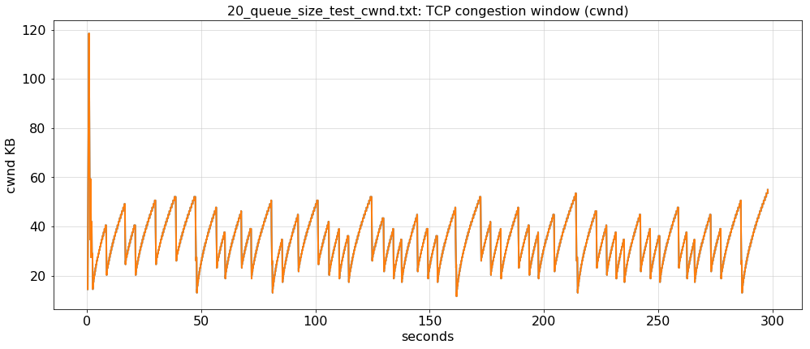
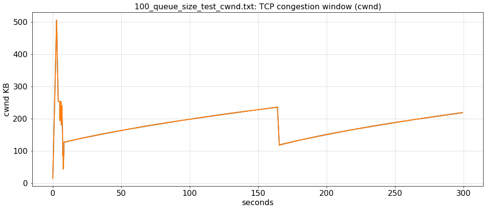
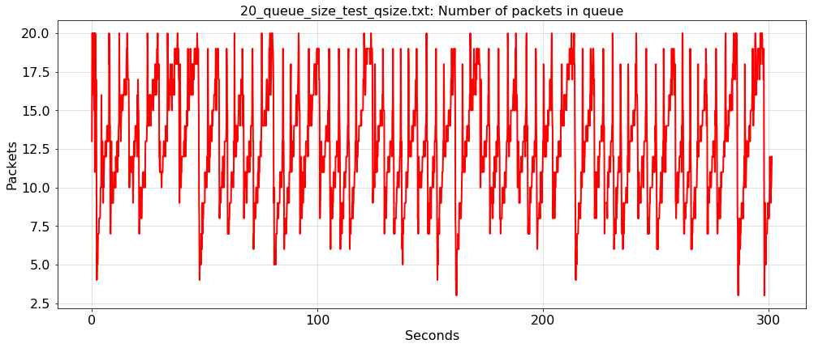
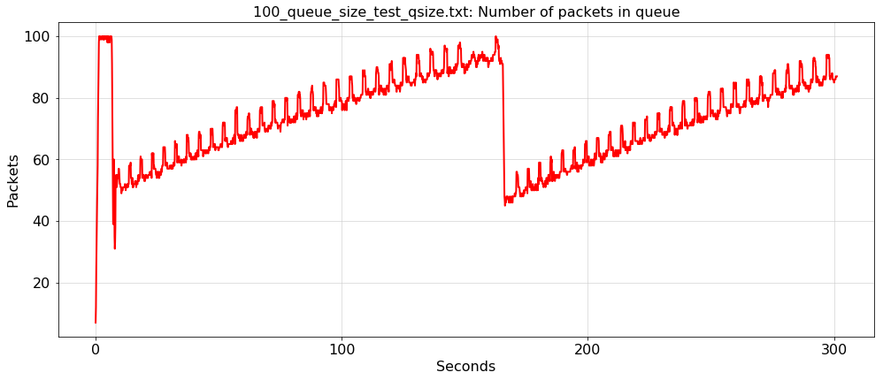
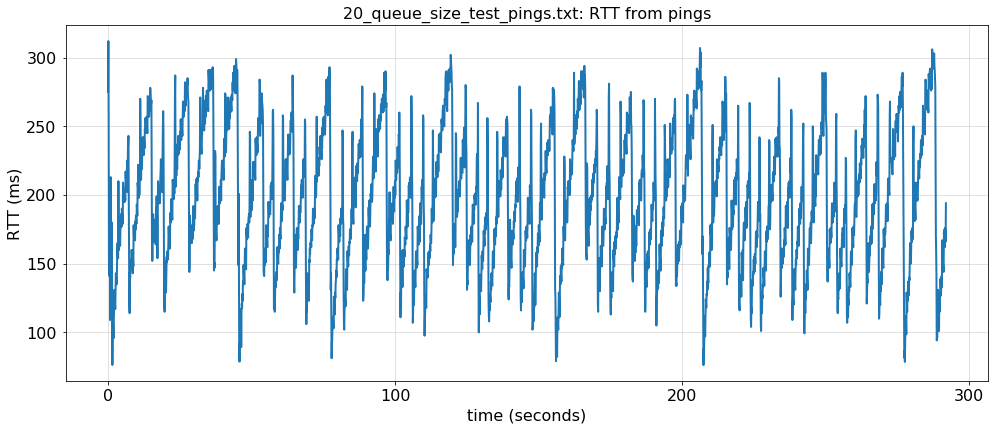
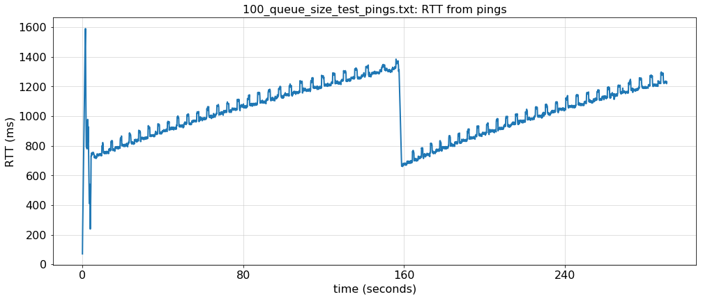

# 华东师范大学数据科学与工程学院实验报告

- 课程名称：计算机网络
- 年级：大二
- 指导教师：赵明昊
- 姓名：刘嘉逸
- 学号：10254602402

## 一、实验任务

本次实验为 Assignment 2：TCP 拥塞控制与缓冲区膨胀（Bufferbloat）。我在课程提供的 `Assignment2_Notebook.ipynb` 中补全 TODO，利用 Mininet 创建网络，运行 TCP Reno，比较不同队列容量对拥塞窗口、排队长度、ping RTT 和网页下载时间的影响。

实验拓扑为 `h1—s0—h2`。h1 作为 Web 服务器和 iperf 数据发送端，h2 作为网页请求端和 iperf 接收端。h1 与 s0 之间的带宽为 1 Gbit/s，s0 与 h2 之间为 1.5 Mbit/s，往返传播时延为 20 ms。两组实验分别将队列容量设置为 20 个包和 100 个包，每组运行时间参数设为 300 秒。

实验分为三部分：Part A 完成拓扑、流量生成和测量代码；Part B 绘制两组实验的 cwnd、队列长度和 RTT，共六张图；Part C 回答六道分析题。这里的 20 和 100 是队列容量上限，不是数据包大小，也不是实验发送的数据包总数。

## 二、使用环境

| 用途 | 环境或工具 |
|---|---|
| 宿主系统 | Windows |
| 当前使用的仓库 | `D:\programming\COS461-Public` |
| 虚拟机 | Windows 中通过 Vagrant、VirtualBox 启动的课程旧版 Ubuntu |
| 实际编辑和实验运行 | 虚拟机中的 Jupyter Notebook，通过 Windows 浏览器访问 |
| 虚拟机工作目录 | `/vagrant/assignment2` |
| Notebook 内核 | Python 2，已保存的内核版本元数据为 2.7.12 |
| Notebook 软件 | 本次安装的 notebook 5.7.16 |
| 网络与测量工具 | Mininet、iperf、ping、curl、tcpprobe 和课程提供的监控脚本 |
| 绘图 | 课程提供的绘图脚本与 Matplotlib |

最初我计划在 WSL Ubuntu 22.04 中编辑，再到 Windows 启动的 Vagrant 虚拟机中运行。后来发现课程提供的 Jupyter 已有较好的编辑体验，因此改为以 Windows 仓库为准，在 Vagrant 的 Jupyter 中直接编辑、执行；WSL 中较旧的副本不再用于本次实验。Windows 的 `assignments` 目录与虚拟机 `/vagrant` 共享，所以虚拟机保存的 Notebook 会直接反映到 Windows 文件中。

本实验使用 Python 2 和旧版 Linux 的相关接口，因此没有把在 Windows 或 WSL 中阅读、检查代码当成运行验证。实际实验由我在 Vagrant 中执行，AI 协助解释要求、检查代码和整理结果。

## 三、实验过程

### 1. 阅读资料与理解基本概念

我阅读了 Notebook 和老师提供的《实验2 TCP拥塞控制和缓冲区膨胀.pdf》《实验2 jupyter环境使用方法.pdf》，并参考课程课件。开始时我对 TCP、socket、RTT、拓扑和拥塞窗口的含义不够熟悉，在阅读过程中逐项提问并结合实验理解。

TCP 是传输协议，socket 是程序调用网络功能的接口。TCP 拥塞窗口 cwnd 是发送端维护的动态变量，限制允许尚未被确认的数据量；它不是交换机队列容量。RTT 是一次请求发出到对应响应返回的往返时间，ping 可以提供连续的 RTT 样本。交换机出口队列保存等待从该接口发送的数据包，实际队列长度会随时间变化，而队列容量是设定的上限。

### 2. Jupyter 启动失败与依赖安装

我第一次在虚拟机中执行：

```bash
sudo jupyter notebook &
```

启动失败，错误为：

```text
Exception: Jupyter command `jupyter-notebook` not found.
```

随后执行 `command -v jupyter`、`command -v jupyter-notebook`，并比较 sudo 环境中的结果。两种环境都只能找到 `/usr/local/bin/jupyter`。使用以下命令检查安装情况：

```bash
python2 -m pip show notebook jupyter-core
```

结果显示 `jupyter-core` 为 4.6.3，但没有安装 `notebook`。因此原因是缺少 Notebook 组件，而不是 Python 2 未安装或仅仅是 sudo 的搜索路径不同。

第一次补装时执行：

```bash
sudo python2 -m pip install "notebook==5.7.16"
```

安装在 Send2Trash 依赖处失败：pip 选择了 Send2Trash 2.0.0，其构建要求 `setuptools>=75.3.1`，当前 Python 2 环境无法满足。随后同时限制这个依赖的版本：

```bash
sudo -H python2 -m pip install "Send2Trash==1.5.0" "notebook==5.7.16"
```

这次日志明确显示安装成功，包括 notebook 5.7.16、Send2Trash 1.5.0、ipykernel 4.10.1 和 pyzmq 19.0.2。Python 2 停止维护提示不是本次安装失败的直接原因。之后我成功进入 Jupyter 并运行了 Notebook。

### 3. Part A：建立拓扑

我首先创建 h1 和 h2，然后依次添加两条链路：

```python
h1 = self.addHost('h1')
h2 = self.addHost('h2')
self.addLink(h1, 's0', bw=1000, delay='5ms',
             max_queue_size=queue_size)
self.addLink('s0', h2, bw=1.5, delay='5ms',
             max_queue_size=queue_size)
```

这里 `bw` 的单位是 Mbit/s，不是 MB/s。网络速率使用十进制前缀，因此 1 Gbit/s 对应 1000 Mbit/s，不是 1024。两条链路各设置单向时延 5 ms，往返传播时延为 `2 × (5 + 5) = 20 ms`；真实测量还包含发送、处理和排队开销。

当前实现给两条链路都设置了 `max_queue_size`。实验重点观察的是 s0 到 h2 的瓶颈出口；该链路第二个添加，因此对应接口为 `s0-eth2`。这不是整个交换机全部接口的缓冲区总容量。

### 4. 启动 TCP 流与 ping

iperf 服务端由提供的代码在 h2 上启动。我补全 h1 上的客户端：

```python
h2 = net.get('h2')
server = h2.popen("iperf -s -w 16m", shell=True)
h1 = net.get('h1')
h1.popen("iperf -c {} -t {}".format(h2.IP(), experiment_time),
         shell=True)
```

`-s` 表示服务端，`-c` 指定客户端连接的目标，`-t` 指定持续时间。`-w 16m` 请求较大的 socket 缓冲区，以尽量避免接收窗口限制实验；它是容量，不是 16 ms，也不是交换机的缓冲区。

编写 ping 时，我最初把目标写成了 `h1.IP()`，并漏掉 `shell=True`。检查后理解到这会让 h1 ping 自己，而且重定向需要 shell 解释，于是修正为：

```python
h1.popen("ping -i {} {} > {}".format(0.1, h2.IP(), outfile),
         shell=True)
```

这样从 h1 每隔 0.1 秒向 h2 发送 ping，并把输出保存到对应文件。`popen()` 启动进程后返回，使 iperf 与 ping 能同时运行。

### 5. 理解监控、Web 服务与下载测量

我保留课程提供的辅助函数，并阅读它们的作用。`start_tcpprobe()` 启动 `cat /proc/net/tcpprobe`，持续把内核 TCP 探测记录保存到文件。该接口不是普通磁盘文件，读取时可以等待后续记录，因此 cat 进程不会像读取普通文本那样很快结束。它观察 TCP 的拥塞窗口，不是交换机队列；该启动函数本身没有单独筛选 iperf 连接。

`start_qmon()` 使用独立进程调用 `monitor_qlen()`，默认每 0.1 秒记录接口队列长度；`start_webserver()` 在 h1 运行提供的 Web 服务；`fetch_webserver()` 在 h2 使用 curl 下载网页，收集总耗时，并用 NumPy 计算平均值和标准差。网页内容被写入 `/dev/null`，但传输本身仍然发生。

下载函数每轮先等待 3 秒，再等待此次下载完成，因此不是严格每隔 3 秒发起一次请求。它测量 HTTP 请求完成的时间，不包含浏览器渲染，也不等于一次 ping RTT。

### 6. 组织实验与修正调用顺序

我在 `bufferbloat()` 中补上队列监控、iperf、ping、Web 服务和下载测量：

```python
outfile = "{}_qsize.txt".format(experiment_name)
qmon = start_qmon(iface="s0-eth2", outfile=outfile)
start_iperf(net, experiment_time)
outfile = "{}_pings.txt".format(experiment_name)
start_ping(net, outfile)
start_webserver(net)
fetch_webserver(net, experiment_time)
```

框架先设置 Reno、创建网络、执行连通性测试并启动 cwnd 记录。最后的下载函数持续执行时，前面启动的流量和监控同时运行。结束后停止监控、关闭网络并执行课程提供的清理代码。原有 `killall -9 cat` 会结束所有同名 cat 进程，清理范围较宽；这里保留作业写法，没有将它改成精确的进程管理实现。

两组实验最初调用时，我把实验名称和时长的位置写反了。核对函数签名 `bufferbloat(queue_size, experiment_time, experiment_name)` 后，修正为：

```python
from subprocess import call
call(["mn", "-c"])
bufferbloat(20, 300, "20_queue_size_test")
bufferbloat(100, 300, "100_queue_size_test")
```

第一次执行调用单元时又出现 `NameError: name 'bufferbloat' is not defined`。这是因为当前内核还没有执行定义函数的单元。Notebook 中写在前面的代码并不会自动运行；我随后按顺序执行前面的定义单元，再执行实验调用。Shift+Enter 执行当前单元并选中下一个，`In [*]` 表示内核正在执行。

实际运行时两组基础 ping 测试均显示 `0% dropped (2/2 received)`，随后持续打印网页下载耗时。这个结果仅证明基础连通性检查通过，不表示实验全程没有丢包。Mininet 日志的粉红色背景对应 stderr 输出，本身不代表异常。

### 7. Part B：绘图与实际测量结果

我使用与实验名称完全一致的列表调用绘图函数：

```python
plot_measurements(["20_queue_size_test", "100_queue_size_test"])
```

检查过程中发现我曾在绘图后重新运行实验，因此需要重新执行绘图单元，才能让图像对应更新后的数据。当前保存的 Notebook 已包含六张图。两组数据文件分别以 `20_queue_size_test` 和 `100_queue_size_test` 为前缀，后缀为 `_cwnd.txt`、`_qsize.txt` 和 `_pings.txt`。

本报告采用整理时 Notebook 中最新保存的下载统计：

| 队列容量 | 平均网页下载时间（秒） | 标准差（秒） |
|---|---:|---:|
| 20 包 | 1.05152054795 | 0.598231688970 |
| 100 包 | 2.28073214286 | 0.963474784515 |

100 包配置的平均下载时间约为 20 包配置的 2.17 倍，标准差也更大。本次交流中较早一轮运行曾得到约 1.094 秒和 2.386 秒的均值，说明重复运行存在波动；这里没有将不同轮次的数据混为同一次测量，也没有把它们当成多次重复实验的汇总统计。

下列图像直接从当前 Notebook 保存的输出导出，不是重新模拟的数据。













从我提供的六张图中，20 包配置的窗口频繁上升和下降，队列长度也反复起伏；100 包配置则允许更多包长期积压，窗口持续增长的阶段较长。此前截图中，100 包配置约在 165 秒附近出现 cwnd、队列长度和 RTT 的相近时段下降，与发送方减小窗口后积压减少的机制一致。不过，单凭图像不能确定具体丢包事件或断言每次下降都由三个重复 ACK 触发；以上时间点是对截图的近似读取，不是对全部原始记录逐点计算。

截图中，20 包配置的 RTT 大多约为 100～300 ms，100 包配置在启动阶段之后大多约为 650～1400 ms。图像显示较大队列伴随明显较高的 RTT；最新下载统计也显示 100 包配置下网页访问更慢。图中的范围是观察值，并非计算得到的 RTT 均值。

### 8. Part C：分析思路与当前填写情况

Q1 要求寻找家庭网络以外的类似场景。我选择校园网。更准确的解释是校内高速连接汇聚到相对有限的互联网出口，大量用户同时向外发送数据时可能形成瓶颈；并不能笼统断言校园网的用户到路由器一定比服务器到路由器慢。当前 Notebook 的 A1 仍使用后一种较粗略的表述，需要进一步修订。

Q2 中，我最初把 q 理解成总共要传输的包数。讨论后明确：对于单个主要瓶颈的近似模型，q 应是被测包前方实际排队的包数，L 为包长（bit），v 为出口速率（bit/s），t 为无排队时的基础 RTT（秒）：

$$
RTT \approx t+\frac{qL}{v}
$$

这里假设其他队列的等待可以忽略，测量期间队列变化不大；如果去程和回程都有显著排队，应分别累加各队列的等待时间。传播可以流水重叠，因此不是每排一个包就再增加一次 20 ms 基础传播时间。当前 Notebook 的 A2 虽已统一使用秒，但 q、t 和带宽的文字定义仍需要按上述含义细化。

Q3 的关键是：瓶颈速率固定，较大的缓冲区能吸收更多积压，推迟因队列溢出而产生的丢包反馈。Reno 可能继续增大窗口，维持更长队列，增加 RTT 和网页下载时间。没有丢包并不代表没有拥塞。当前 A3 已填写这一机制，但尚未把图像和测量数据明确引用进答案；本报告前一节整理了相关证据。

Q4 我采用超市收银台的类比：扩大排队区没有提高结账速度，持续有大量顾客到来时，只会允许更多人等待。

Q5 说明缓冲区膨胀并非 Reno 或家庭网络独有，同时适当的缓冲可以吸收短时突发、减少丢包，不能简单认为缓冲越小越好。

Q6 提出主动队列管理：在排队时延持续过高时提前丢包或在支持的连接上使用 ECN 标记，促使发送方降速，而不必降低物理容量上限。这里是原理分析，没有在本实验中额外部署或测试 CoDel、ECN 等方案。

### 9. 文件变化与记录边界

实验期间我注意到 Notebook 的 Python 版本元数据从 2.7.6 变为 2.7.12，这与使用当前内核保存文件的行为一致，不是修改 TCP 实验逻辑。Assignment1 四个文件也出现整文件 diff，检查确认是 Git 索引中的 CRLF 与工作文件中的 LF 不同。环境说明包含遍历 `/vagrant` 执行 dos2unix 的命令，它可能造成这类变化，但本次没有证据确认具体由哪次操作触发，因此没有把可能原因写成已证实事实。

## 四、总结

本次实验中，我在 Vagrant 的 Jupyter 中补全了 Mininet 拓扑、iperf、ping、实验组织和绘图调用，运行了 20 包与 100 包两组实验，并保存六张结果图。最新保存结果显示，队列容量增大后网页平均下载时间由约 1.052 秒增加到 2.281 秒，RTT 图也表现出更高的排队延迟。

我理解到缓冲区容量、实际队列长度、socket 缓冲区和 TCP 拥塞窗口是不同概念。cwnd 随连接状态动态变化，而交换机队列容量是本次实验控制的配置参数。增大缓冲区不能增加瓶颈链路带宽；在持续负载下，它可能允许更多数据长期等待，推迟拥塞反馈并降低交互体验。但对于短时突发，合理的缓冲仍有作用。

实验的真实过程包括旧版依赖安装失败、ping 目标与 shell 参数修正、函数参数顺序修正，以及未先执行定义单元导致的 NameError。通过逐步解释和检查，我逐渐把代码调用与网络行为联系起来。AI 参与了概念讲解、代码检查和报告整理，实际 Notebook 编辑、实验执行及结果提供由我完成。