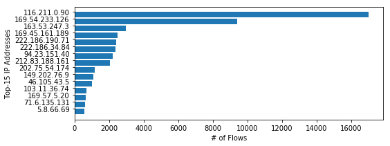
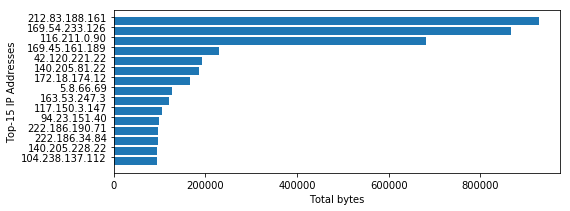
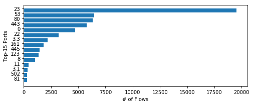
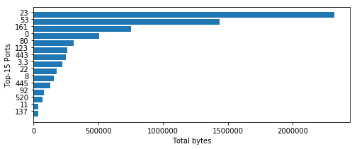

# 华东师范大学数据科学与工程学院实验报告

- 课程名称：计算机网络
- 年级：大二
- 指导教师：赵明昊
- 姓名：刘嘉逸
- 学号：10254602402

## 一、实验任务

本次实验为 Assignment 3：被动网络测量。我在课程提供的 `Assignment3_Notebook.ipynb` 中完成两部分分析。Part A 读取校园网边界路由器采集的 NetFlow 数据，分别按流记录数和总字节数对外部 IP 和低编号端口排名，绘制四张图并回答五道问题。Part B 读取 RouteViews 的 BGP 路由表快照，找出不同 AS 编号最多的路径，并回答两个与路径有关的问题。

## 二、使用环境

| 用途 | 环境或工具 |
|---|---|
| 宿主系统与工作仓库 | Windows，`D:\programming\COS461-Public` |
| 课程虚拟机 | Vagrant、VirtualBox、Ubuntu 14.04.6 LTS |
| Notebook | 虚拟机中的 Jupyter Notebook 5，Python 2 内核 |
| 编辑与执行 | 从 Windows 浏览器访问 `http://127.0.0.1:8888` |
| 虚拟机作业目录 | `/vagrant/assignment3` |
| 数据、绘图与校验 | `netflow.csv`、`bgp_rib.csv`、`plotting.py`、`testing.py` |

## 三、实验过程

### 1. 阅读题目并连接 Jupyter

我阅读了老师提供的中文版说明和 Notebook。开始时我先弄清楚 BGP 路由表记录的是什么，以及 `PREFIX` 中 `/24` 表示 IPv4 地址前 24 位固定。NetFlow 用来分析抓包期间观察到的流量，BGP 快照用来分析观察点收到的路由信息。

我用 `vagrant status` 确认虚拟机已经运行，再通过 `vagrant ssh` 进入虚拟机。我先后用 `sudo jupyter notebook &` 启动了三次。由于 8888 和 8889 已被占用，新进程依次监听 8890、8891 和 8892。在提示符处按 Ctrl+C 后，这些后台任务仍在运行。

我用 `jobs -l` 和 `netstat` 查到三个新进程，并发送 SIGTERM 停止它们。随后用 `ps` 确认 8888 和 8889 上原有的进程也是 Jupyter，再在 Windows 上用 `vagrant port` 确认虚拟机 8888 映射到宿主机 8888。最后在 Windows 浏览器中打开 8888 上已有的服务，进入 `assignment3` 编辑并运行 Notebook。

### 2. Part A：统计外部 IP

Notebook 用 `csv.DictReader` 读取了 105,360 条流记录。编写统计函数时，我先弄清楚 `current_flow` 是一条记录，`counts` 是传给下一轮的累积字典。我逐步修正了字典键、校园网前缀的判断方向和返回值。计数时每条流记录加 1，统计流量时把字符串字段 `Bytes` 转为整数后累加，保留字节单位。

最初我只检查目的 IP，得到的两项排名无法通过课程校验。AI 用同一份 CSV 对照不同统计口径后，发现分别检查源 IP 和目的 IP 才能使两项前 15 名的哈希与课程预期一致。我据此改为分别处理 `Src IP addr` 和 `Dst IP addr`，把每个不以 `128.112.` 开头的端点计入统计。

修改后单元格一度长时间显示 `In [*]`。代码在 Python 2 中每次调用 `counts.keys()` 都会创建键列表，再逐项查找。我改用 `key in counts` 直接查字典后，单元格正常输出。此前 AI 在宿主机做的复算确认了统计口径，但没有反映 Python 2 中复制键列表的开销。

| 排名 | 按流记录数（IP、条数） | 按总字节数（IP、字节数） |
|---:|---|---|
| 1 | 116.211.0.90，17,015 | 212.83.188.161，928,311 |
| 2 | 169.54.233.126，9,424 | 169.54.233.126，867,928 |
| 3 | 163.53.247.3，2,981 | 116.211.0.90，680,600 |
| 4 | 169.45.161.189，2,494 | 169.45.161.189，229,448 |
| 5 | 222.186.190.71，2,413 | 42.120.221.22，191,958 |

Q2 最初在 Vagrant 终端对旧榜单中的 `103.11.36.74` 和 `172.18.174.12` 执行了 `whois`。榜单修正后，AI 协助改用新榜单中的两个地址，查询了在线登记记录，并从 CSV 核对它们的流量特征。新版答案使用的是在线查询，目前没有这两个新地址在 Vagrant 终端运行 `whois` 的记录。

- `116.211.0.90` 所在地址段登记为中国电信湖北网络。数据中该地址向校内多个 TCP 端口发出了大量仅带 SYN 标志的小流，这种模式与批量连接探测相符，可能解释它的流记录数为何排第一。[APNIC WHOIS](https://wq.apnic.net/apnic-bin/whois.pl?object_type=inetnum&searchtext=116.208.0.0)
- `169.54.233.126` 所在地址段与 IBM Cloud（SoftLayer）关联。该地址向校园网 UDP 17185 端口发送的 9,424 条流累计 867,928 字节，解释了它为什么在两个榜单中都排第二。登记信息和流记录只能提供网络归属与通信特征，具体应用和发起者无法确定。[地址段查询](https://ipregistry.co/AS36351/169.54.192.0/18) · [ARIN 登记记录](https://whois.arin.net/rest/asn/AS36351.html)

### 3. Part A：统计端口并分析结果

端口统计遍历全部流记录，分别检查源端口和目的端口。符合小于 1024 条件的字段分别计数和累加字节数。初版用 `int()` 比较端口，遇到 ICMP 记录中的 `'3.3'` 时抛出 `ValueError`。我将比较改为 `float(port) < 1024`，保留原始字符串作为字典键，使检查函数能够拼接端口值。两项端口校验随后通过。

| 排名 | 按流记录数（端口、条数） | 按总字节数（端口、字节数） |
|---:|---|---|
| 1 | 23，19,546 | 23，2,324,852 |
| 2 | 53，6,480 | 53，1,437,375 |
| 3 | 80，6,352 | 161，752,840 |
| 4 | 443，5,788 | 0，509,011 |
| 5 | 0，4,712 | 80，309,148 |

Q3 中，23、53、80、443 和 161 分别常用于 Telnet、DNS、HTTP、HTTPS 和 SNMP。端口字段为 0 的 4,712 次出现中，有 4,647 次来自 ICMP 记录，因此这里的 0 主要反映数据记录方式。DNS 在两项排名中都靠前，23 端口在两项中均排第一则比较意外。[IANA 端口登记表](https://www.iana.org/assignments/service-names-port-numbers/)

Q4 中，AI 协助复核了 23 端口的记录。校园网外发往校内 23 端口的流有 19,380 条，其中 19,194 条只记录了 TCP SYN 标志。大量小流累加起来，可以解释 23 端口的高总字节数。该模式符合批量探测的特征，连接是否成功无法从这一统计确定。

Q5 讨论了采样窗口的影响。题目给出的时间为早上 6:05–6:10，我推测这时校园用户活动较少，后台通信和外部探测的占比可能较高。如果改在工作日下午 2:00–2:05 抓包，网页访问和 DNS 查询可能增多，23 端口探测的相对占比可能降低。本实验只分析了课程提供的一段记录，未实测其他时段。

### 4. Part B：分析 BGP 路由表

Notebook 以分号为分隔符读入了 208,272 条 BGP RIB 记录。我先理解了 `FROM`、`ASPATH`、`PREFIX` 和 `NEXT_HOP` 的区别。排序时，我将 `ASPATH` 按空格拆分，用集合统计不同 ASN 的数量，再取排序后第一条记录的原始路径。期间修正了字典键要加引号、字符串方法 `split()` 要用圆括号调用的问题。最终最长路径通过课程校验。

这条路径共有 21 个 ASN 条目，其中 12 个 ASN 各不相同。`AS131284` 在路径中连续出现 10 次。Q6 在 AI 协助下查询并填写了各 AS 的登记国家，按路径顺序列在下表。登记国家用于描述 AS 的注册信息，无法据此判断数据包实际经过的地理位置。

| ASN | 登记国家 |
|---|---|
| 20562 | 荷兰 |
| 9002 | 英国 |
| 9198 | 哈萨克斯坦 |
| 12997 | 吉尔吉斯斯坦 |
| 51346 | 塔吉克斯坦 |
| 24722 | 塔吉克斯坦 |
| 8449 | 吉尔吉斯斯坦 |
| 3356 | 美国 |
| 38193 | 巴基斯坦 |
| 55330 | 阿富汗 |
| 131284（连续 10 次） | 阿富汗 |
| 58630 | 阿富汗 |

Q7 中，我从时延和运维两个角度解释长路径。若路径确实经过更多中转网络，绕行和跨网拥塞可能增加时延；路径涉及的运营商越多，发生丢包或路由策略变化时，定位和协调也可能更复杂。本实验没有测量该路径的实际时延。

## 四、总结

本次实验完成了 NetFlow 的两项 IP 统计、两项端口统计和 BGP 最长路径计算。最终保存的 Notebook 中，五项课程哈希校验均通过，四张图均已保存，七道问答均已填写。报告中的四张图直接导自 Notebook 的保存输出。
